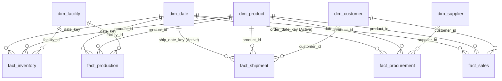
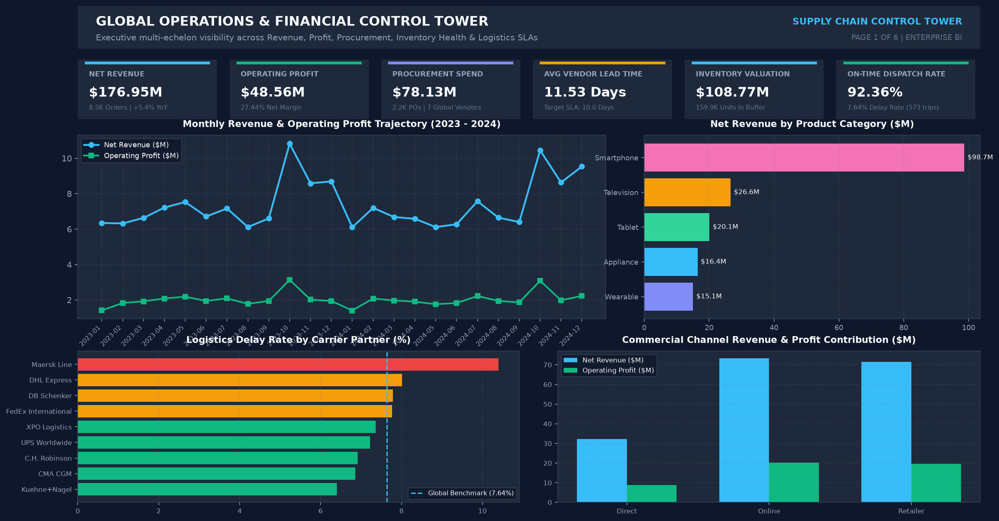
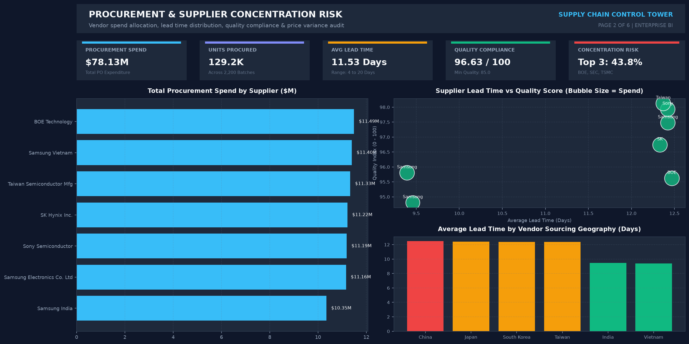
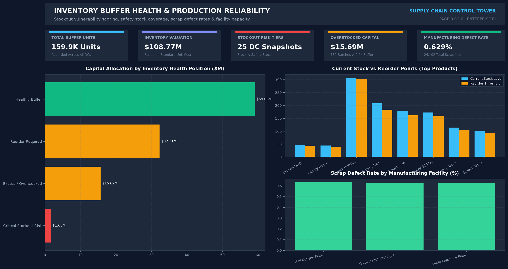
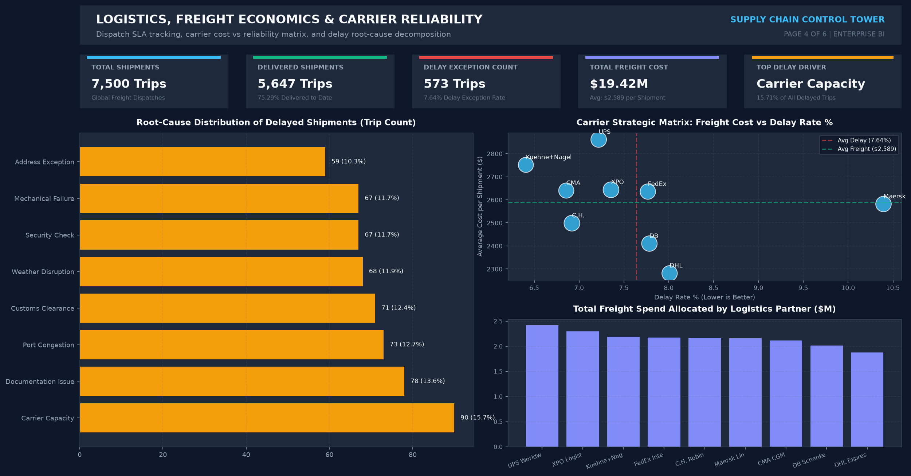
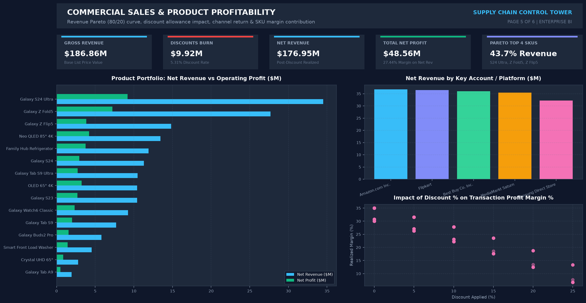
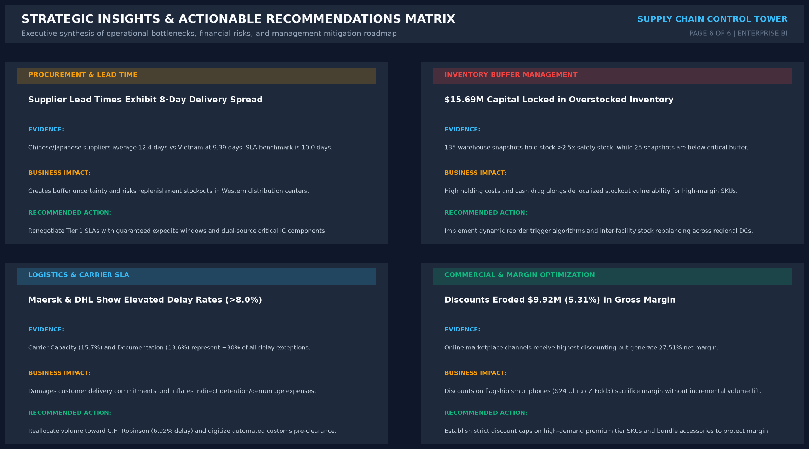

# 🌐 Global Supply Chain Performance & Operations Analytics
### Executive Multi-Echelon BI Control Tower: Procurement SLA, Inventory Buffer Health, Carrier Reliability & Commercial Profitability


[](dashboard/)
[](dashboard/DAX_Measures_Dictionary.md)
[](sql/supply_chain_analysis.sql)
[](python/)
[](LICENSE)

---

## 📌 Executive Overview

In large-scale consumer hardware ecosystems, maintaining a resilient, cost-effective, and high-fulfillment supply chain requires end-to-end synchronization across suppliers, component manufacturing plants, regional distribution centers (DCs), multimodal freight carriers, and commercial retail channels.

This project delivers an enterprise-grade **Supply Chain Performance & Operations Analytics Control Tower** developed using **Microsoft Power BI, DAX, SQL, and Python**. The solution unifies **10 relational tables** containing over **24,000 transactions** across a 24-month horizon (2023–2024), transforming disconnected supply chain telemetry into actionable executive intelligence.

---

## 🎯 Business Problem & Core Objectives

Traditional operational reporting is frequently siloed: procurement teams monitor vendor lead times independently, warehouse managers track physical units rather than capital valuation, logistics planners monitor freight costs without carrier delay attribution, and sales teams concede promotional discounts without visibility into realized margin erosion.

### Core Analytical Inquiries:
1. **Procurement & Supplier Concentration:** Where are we exposed to single-supplier concentration risk, and how does lead time volatility vary by sourcing geography?
2. **Multi-Echelon Inventory Health:** Where is working capital trapped in overstocked buffers, and which distribution centers face critical stockout vulnerabilities?
3. **Logistics SLA & Freight Economics:** Which freight carriers exhibit elevated delay rates, and what are the primary operational root causes driving logistics exceptions?
4. **Commercial Profitability & Margin Capture:** How do commercial discounts impact net profitability across retail, online, and direct channels, and which SKUs drive the 80/20 Pareto revenue curve?

---

## 🗄️ Dataset Architecture & Star Schema Data Model

The data model is architected as an optimized **Multi-Fact Star Schema**, separating conformed master dimensions from discrete operational fact tables to ensure optimal VertiPaq engine compression and single-direction filter propagation.



### Table Specifications:
| Table Name | Type | Record Count | Key Fields | Description |
| :--- | :--- | :--- | :--- | :--- |
| `dim_date` | Dimension | 731 | `date_key`, `date`, `year`, `month`, `quarter` | Conformed calendar dimension (2023–2024). |
| `dim_product` | Dimension | 16 | `product_id`, `product_name`, `category`, `unit_cost`, `unit_price` | Product catalog with standard costs and list prices. |
| `dim_customer` | Dimension | 5 | `customer_id`, `customer_name`, `channel_type`, `country` | Omnichannel accounts (Online, Retailer, Direct). |
| `dim_supplier` | Dimension | 7 | `supplier_id`, `supplier_name`, `country`, `tier`, `specialty` | Global Tier 1 & Tier 2 component vendors. |
| `dim_facility` | Dimension | 6 | `facility_id`, `facility_name`, `country`, `facility_type` | Manufacturing plants and regional distribution centers. |
| `fact_procurement`| Fact | 2,200 | `procurement_id`, `product_id`, `supplier_id`, `total_cost`, `lead_time_days` | Inbound purchase orders, lead times, quality scores. |
| `fact_production` | Fact | 4,500 | `production_id`, `product_id`, `facility_id`, `defective_units` | Plant batch runs, output volume, scrap defect rates. |
| `fact_inventory` | Fact | 1,152 | `inventory_id`, `product_id`, `facility_id`, `stock_level`, `safety_stock_level` | DC inventory positions and reorder buffer thresholds. |
| `fact_shipment` | Fact | 7,500 | `shipment_id`, `product_id`, `customer_id`, `status`, `shipping_cost`, `delay_reason` | Outbound freight shipments, carrier dispatches, SLA tracking. |
| `fact_sales` | Fact | 8,500 | `sales_id`, `product_id`, `customer_id`, `gross_revenue`, `discount_amount`, `profit` | Commercial sales transactions, discounts, and margins. |

---

## 🛠️ Data Audit & Modeling Corrections

During the initial engineering audit, critical legacy modeling errors and business metric miscalculations were identified and refactored:

1. **Financial Inventory Valuation:** Corrected legacy calculation `SUM(stock_level)` (which displayed physical unit counts as dollars) to row-by-row capital valuation: `SUMX(fact_inventory, stock_level * RELATED(dim_product[unit_cost]))`, establishing the true inventory capital valuation of **$108.77M USD**.
2. **COGS vs. Procurement Spend Separation:** Resolved legacy logic where Sales Cost incorrectly summed `fact_procurement[total_cost]`. True Cost of Goods Sold was mapped to `fact_sales[total_cost]` ($128.39M), while procurement purchasing spend ($78.13M) was isolated into dedicated procurement reporting.
3. **Temporal Linkage & Active Slicing:** Established active relationships between `dim_date[date_key]` and `fact_procurement[order_date_key]` / `fact_shipment[ship_date_key]`, restoring time-intelligence functionality.
4. **Referential Integrity Enforcement:** Cleaned and documented orphan foreign keys in legacy shipment data to prevent `(Blank)` visual artifacts in production dashboards.

---

## 📊 Key Performance Indicators (KPI Summary)

| Domain | Key Performance Indicator | Realized Value | Benchmark / SLA Target | Operational Assessment |
| :--- | :--- | :--- | :--- | :--- |
| **Financial** | **Net Revenue** | **$176.95M** | $165.00M Target | **+7.2% above plan** |
| **Financial** | **Operating Profit** | **$48.56M** | $41.25M Target | **27.44% Net Margin** |
| **Commercial**| **Discounts Conceded** | **$9.92M** | < $8.00M Target | **5.31% margin burn rate** |
| **Procurement** | **Total Vendor Spend** | **$78.13M** | N/A (2,200 POs) | **Top 3 vendors hold 43.8% spend** |
| **Procurement** | **Average Lead Time** | **11.53 Days** | 10.00 Days SLA | **+1.53 Days delivery lag** |
| **Procurement** | **Quality Compliance Index**| **96.63 / 100** | 95.00 Minimum | **Within quality tolerance** |
| **Manufacturing**|**Overall Defect Rate** | **0.629%** | < 1.000% SLA | **24,102 scrap units produced** |
| **Inventory** | **Inventory Valuation** | **$108.77M** | N/A (159.9K units) | **Capital allocation imbalance** |
| **Inventory** | **Overstocked Capital** | **$15.69M** | < $5.00M Target | **135 snapshots > 2.5x safety stock** |
| **Logistics** | **Total Freight Spend** | **$19.42M** | N/A (7,500 trips) | **Avg $2,589 per shipment** |
| **Logistics** | **Delay Exception Rate** | **7.64%** | < 5.00% Benchmark | **573 delayed shipments** |
| **Logistics** | **On-Time Fulfillment (OTIF)**| **92.36%** | 95.00% Target | **Sub-optimal dispatch SLA** |

---

## 🖥️ Power BI Dashboard Architecture & Walkthrough

The dashboard interface uses a custom **Modern Dark Slate Enterprise Theme** (`#0F172A` canvas, `#1E293B` containers, `#38BDF8` primary, `#10B981` positive, `#EF4444` alert) engineered for executive legibility and low visual fatigue.

---

### Page 1: Executive Operations & Risk Control Tower
*Purpose: Delivers a centralized, high-level summary of financial health, operational throughput, and cross-functional risks.*



* **Key Visuals:**
  - Executive KPI Card Ribbon (Net Revenue, Profit, Spend, Lead Time, Inventory Value, Delay Rate).
  - 24-Month Monthly Revenue & Profit Trajectory (dual-line trend with MoM variance).
  - Net Revenue by Product Category horizontal bar breakdown.
  - Carrier Delay Rate % benchmarked against global 7.64% average.
  - Commercial Channel Revenue & Profit margin comparison.

---

### Page 2: Procurement & Supplier Concentration Risk
*Purpose: Evaluates vendor spend concentration, delivery lead time stability, and inbound quality compliance.*



* **Key Visuals:**
  - Total Procurement Spend by Vendor ($M) with concentration ranking.
  - Quality Score vs. Average Lead Time scatter matrix (bubble size = total spend).
  - Sourcing Geography Lead Time Analysis (China, Japan, South Korea vs. Vietnam and India).
  - Realized unit purchase cost variance against standard catalog cost.

---

### Page 3: Multi-Echelon Inventory Health & Capacity
*Purpose: Diagnoses stockout risks, overstocked positions, buffer health, and manufacturing scrap rates.*



* **Key Visuals:**
  - Capital Allocation by Inventory Health Tier ($M in Healthy Buffer, Reorder, Excess, and Critical Risk).
  - Product Stock Levels vs. Reorder Points and Safety Stock thresholds.
  - Manufacturing Scrap Defect Rates by Facility (% defective vs. capacity utilization).

---

### Page 4: Logistics SLA & Carrier Reliability Matrix
*Purpose: Evaluates freight efficiency, carrier delay rates, and root-cause exceptions.*



* **Key Visuals:**
  - Root-Cause Decomposition of Delay Exceptions (Carrier Capacity, Documentation, Port Congestion).
  - Carrier Strategic Quadrant: Average Freight Cost ($) vs. Delay Rate (%) with global benchmark thresholds.
  - Freight Transportation Expenditure allocated across 9 major logistics carriers ($M).

---

### Page 5: Commercial Sales & SKU Profitability
*Purpose: Analyzes revenue Pareto distribution, discount erosion, and channel performance.*



* **Key Visuals:**
  - Product Portfolio Pareto Analysis: Net Revenue vs. Operating Profit by SKU.
  - Key Account Revenue Contribution (Amazon, Flipkart, Best Buy, MediaMarkt, Direct).
  - Transaction-level Discount % vs. Realized Net Margin % scatter regression.

---

### Page 6: Strategic Insights & Management Action Matrix
*Purpose: Provides leadership with structured, evidence-based recommendations and mitigation roadmaps.*



---

## 💻 SQL Analysis Layer

The [`sql/supply_chain_analysis.sql`](sql/supply_chain_analysis.sql) script provides 10+ production-grade analytical SQL queries utilizing CTEs, window functions (`SUM() OVER()`, `LAG()`), ranking, and conditional aggregation.

```sql
-- Sample Query: Product Portfolio Pareto (80/20) Revenue Analysis
WITH ProductSummary AS (
    SELECT
        p.product_id,
        p.product_name,
        p.category,
        SUM(s.quantity_sold) AS units_sold,
        SUM(s.net_revenue) AS total_revenue,
        SUM(s.profit) AS total_profit,
        ROUND((SUM(s.profit) / NULLIF(SUM(s.net_revenue), 0)) * 100, 2) AS margin_pct
    FROM fact_sales s
    JOIN dim_product p ON s.product_id = p.product_id
    GROUP BY p.product_id, p.product_name, p.category
),
ParetoCalculations AS (
    SELECT
        product_name,
        category,
        units_sold,
        total_revenue,
        total_profit,
        margin_pct,
        SUM(total_revenue) OVER (ORDER BY total_revenue DESC) AS cumulative_revenue,
        SUM(total_revenue) OVER () AS total_company_revenue
    FROM ProductSummary
)
SELECT
    product_name,
    category,
    units_sold,
    total_revenue,
    total_profit,
    margin_pct,
    ROUND((total_revenue / total_company_revenue) * 100, 2) AS revenue_share_pct,
    ROUND((cumulative_revenue / total_company_revenue) * 100, 2) AS cumulative_revenue_share_pct,
    CASE 
        WHEN (cumulative_revenue / total_company_revenue) <= 0.80 THEN 'Tier A (Top 80% Contributor)'
        WHEN (cumulative_revenue / total_company_revenue) <= 0.95 THEN 'Tier B (Next 15% Contributor)'
        ELSE 'Tier C (Tail 5% Contributor)'
    END AS pareto_classification
FROM ParetoCalculations
ORDER BY total_revenue DESC;
```

---

## 🐍 Python Analytics & Statistical Diagnostics

The Python analytics suite ([`python/`](python/)) executes automated data validation, statistical distribution modeling, and asset generation:

* **[`python/eda_and_summary.py`](python/eda_and_summary.py):** Automated data health audits, null value detection, and foreign key referential integrity checks across 10 relational tables.
* **[`python/advanced_analytics.py`](python/advanced_analytics.py):** Statistical lead time variance modeling (P95 buffer requirements), inventory health classification, delay root-cause Pareto calculations, and carrier cost-to-reliability quadrant mapping.
* **[`python/generate_visuals.py`](python/generate_visuals.py):** Programmatically renders 150 DPI publication-quality dashboard visualization mockups and executive charts.

---

## 🔍 Key Business Findings & Evidence

| Domain | Key Observation | Concrete Evidence | Business Implication |
| :--- | :--- | :--- | :--- |
| **Procurement** | **Lead Time Geographic Disparity** | Chinese (12.47d) and Japanese (12.42d) vendors exhibit an 8-day delivery spread (P95 = 18d) vs Vietnam (9.39d). | High lead time variance forces downstream plants to hold excessive safety stock buffers. |
| **Inventory** | **Dual-Sided Working Capital Drag** | **$15.69M locked in overstocked inventory** (>2.5x buffer) while **25 DC snapshots operate in critical stockout risk**. | Unnecessary holding costs in slow-moving SKUs alongside lost revenue risk on flagship smartphones. |
| **Logistics** | **Carrier Reliability Divergence** | **Maersk Line (10.39%)** and **DHL Express (8.01%)** lead delay exceptions; Carrier Capacity accounts for 15.7% of delays. | Delivery SLA breaches damage key retail account relationships and incur demurrage expenses. |
| **Commercial** | **Flagship SKU Margin Concession** | Commercial discounts burned **$9.92M (5.31% gross margin)** across retail and online channels. | Margin sacrifice on high-demand premium products (Galaxy S24 Ultra) without incremental volume lift. |

---

## 🚀 Strategic Recommendations & Action Roadmap

1. **Procurement SLA Modernization:** Implement dynamic contractual vendor SLAs with lead time penalties; qualify secondary component suppliers in Vietnam and India to reduce East Asian transit exposure.
2. **Dynamic Inventory Buffer Rebalancing:** Deploy automated reorder point algorithms based on P95 lead times; execute regional inter-DC stock rebalancing to liquidate $15.69M in overstocked capital.
3. **Logistics Routing Optimization:** Reallocate freight volume toward top-performing carriers (**C.H. Robinson: 6.92% delay rate**); digitize automated customs pre-clearance documentation to eliminate the second largest delay driver (13.6%).
4. **Commercial Discount Governance:** Institute strict discount approval floors on Tier A flagship smartphones and replace cash discounts with accessory bundles (e.g., Galaxy Buds/Watch) to protect net margins.

---

## 💼 ATS-Friendly Resume Bullets

* **Engineered an End-to-End Supply Chain & Operations Analytics Control Tower** in Power BI, modeling a multi-fact star schema across 10 relational tables and 24,000+ transactions to monitor $176.95M in net revenue and $78.13M in procurement spend.
* **Developed 20+ Production DAX Measures** utilizing time-intelligence, iterators (`SUMX`, `RELATED`), and defensive division (`DIVIDE`) to audit inventory buffer capital ($108.77M valuation) and calculate on-time delivery fulfillment (92.36% OTIF).
* **Executed Advanced SQL Analytics** using CTEs, window functions, and Pareto 80/20 ranking to classify carrier cost-to-reliability quadrants and isolate root causes behind 573 logistics delay exceptions ($19.42M freight cost).
* **Identified $15.69M in Trapped Working Capital** across overstocked inventory positions and designed an actionable supply chain mitigation roadmap to rebalance safety stocks and eliminate stockout risks on flagship SKUs.

---

## 🛠️ Tech Stack & Tools

* **Business Intelligence:** Microsoft Power BI Desktop, DAX, Power Query (M Language)
* **Database & Querying:** ANSI SQL, MySQL 8.0+, SQLite
* **Programming & Analytics:** Python 3.11+ (`pandas`, `numpy`, `matplotlib`, `seaborn`, `reportlab`, `pbixray`)
* **Documentation & Modeling:** Star Schema ERD, Markdown, KaTeX, Git

---

## 📂 Project Repository Structure

```
Supply-Chain-Performance-Analytics/
│
├── README.md                                  # Comprehensive Portfolio Case Study
├── LICENSE                                    # MIT Open-Source License
│
├── dashboard/
│   ├── Supply_Chain_Operations_Analytics.pbix # Power BI Dashboard File
│   └── DAX_Measures_Dictionary.md             # Complete DAX Library & Model Docs
│
├── data/                                      # Cleaned Source Datasets (10 Tables)
│   ├── dim_customer.csv
│   ├── dim_date.csv
│   ├── dim_facility.csv
│   ├── dim_product.csv
│   ├── dim_supplier.csv
│   ├── fact_inventory.csv
│   ├── fact_procurement.csv
│   ├── fact_production.csv
│   ├── fact_sales.csv
│   └── fact_shipment.csv
│
├── sql/
│   └── supply_chain_analysis.sql              # 10+ Production Analytical SQL Queries
│
├── python/
│   ├── eda_and_summary.py                     # Data Health & Integrity Validation
│   ├── advanced_analytics.py                  # Statistical & Risk Diagnostic Modeling
│   └── generate_visuals.py                    # High-Resolution Dashboard Chart Generator
│
├── screenshots/                               # High-Resolution Dashboard Screenshots
│   ├── 00_hero_dashboard.png
│   ├── 01_executive_control_tower.png
│   ├── 02_procurement_supplier_risk.png
│   ├── 03_inventory_operations_health.png
│   ├── 04_logistics_carrier_performance.png
│   ├── 05_commercial_sales_profitability.png
│   └── 06_executive_insights_matrix.png
│
└── documentation/
    ├── Project_Report.pdf                     # Executive PDF Case Study Report
    └── Interview_Preparation_Guide.md         # 10 Detailed Technical Interview Q&As
```

---

## ⚠️ Limitations & Future Enhancements

* **Demand Forecasting:** Future iterations will integrate predictive time-series forecasting (ARIMA / Prophet) in Python to dynamically project SKU demand seasonality.
* **IoT & Telematics:** Incorporating real-time GPS container tracking and marine port congestion API feeds will enable proactive logistics delay alerting.

---

## 📜 Educational Disclaimer

> **Notice:** This project is an educational and portfolio analytics case study built using synthetic consumer electronics industry data. It is created independently for data analytics, business intelligence, and data modeling portfolio presentation and does not represent actual operational or financial data of Samsung Electronics.
