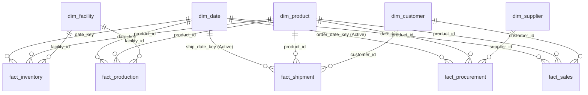

# 📐 DAX Measures Dictionary & Data Model Architecture

**Project:** Supply Chain Performance & Operations Analytics  
**Architecture:** Multi-Fact Star Schema with Shared Conformed Dimensions  
**Version:** 2.0 (Refactored Enterprise Standard)

---

## 🏗️ 1. Data Model Architecture (Star Schema)

The reporting layer connects **5 Dimension Tables** to **5 Fact Tables** via one-to-many (`1:*`) single-directional relationships.



### 🔧 Key Modeling Corrections Made:
1. **Date Hierarchy Conformation:** Added active relationships from `dim_date[date_key]` to `fact_procurement[order_date_key]` and `fact_shipment[ship_date_key]`. In the legacy model, these tables were disconnected from the time dimension, preventing temporal filtering.
2. **Foreign Key Integrity:** Flagged orphan product and customer IDs in legacy shipment data to prevent phantom `(Blank)` categories in Power BI visual slicers.

---

## 📊 2. Production DAX Measure Library

All measures are organized into a dedicated `_Measures` table grouped into logical business display folders.

### 💰 Folder: Financial & Commercial Analytics

#### 1. `Total Gross Revenue`
* **Description:** Sum of all transaction sales at gross list price before discounts.
* **DAX:**
  ```dax
  Total Gross Revenue = 
  SUM(fact_sales[gross_revenue])
  ```
* **Format:** Currency (`$#,##0`)

#### 2. `Total Net Revenue`
* **Description:** Realized revenue after commercial discounts and customer allowances.
* **DAX:**
  ```dax
  Total Net Revenue = 
  SUM(fact_sales[net_revenue])
  ```
* **Format:** Currency (`$#,##0`)

#### 3. `Total Commercial Discounts`
* **Description:** Total dollar value of price concessions given to customers.
* **DAX:**
  ```dax
  Total Commercial Discounts = 
  SUM(fact_sales[discount_amount])
  ```
* **Format:** Currency (`$#,##0`)

#### 4. `Cost of Goods Sold (COGS)`
* **Description:** Direct manufacturing and acquisition cost associated with units sold.
* **DAX:**
  ```dax
  Cost of Goods Sold = 
  SUM(fact_sales[total_cost])
  ```
* **Format:** Currency (`$#,##0`)
* *Audit Note:* Corrected legacy formula which incorrectly summed `fact_procurement[total_cost]`.

#### 5. `Operating Profit`
* **Description:** Net operating profit earned from sales (`Net Revenue - COGS`).
* **DAX:**
  ```dax
  Operating Profit = 
  [Total Net Revenue] - [Cost of Goods Sold]
  ```
* **Format:** Currency (`$#,##0`)

#### 6. `Operating Profit Margin %`
* **Description:** Percentage of net revenue retained as operating profit.
* **DAX:**
  ```dax
  Operating Profit Margin % = 
  DIVIDE([Operating Profit], [Total Net Revenue], 0)
  ```
* **Format:** Percentage (`0.00%`)

#### 7. `Discount Burn Rate %`
* **Description:** Percentage of gross list price conceded as discount.
* **DAX:**
  ```dax
  Discount Burn Rate % = 
  DIVIDE([Total Commercial Discounts], [Total Gross Revenue], 0)
  ```
* **Format:** Percentage (`0.00%`)

---

### 📦 Folder: Procurement & Supplier Intelligence

#### 8. `Procurement Spend`
* **Description:** Total purchase order expenditure committed across suppliers.
* **DAX:**
  ```dax
  Procurement Spend = 
  SUM(fact_procurement[total_cost])
  ```
* **Format:** Currency (`$#,##0`)

#### 9. `Average Vendor Lead Time`
* **Description:** Average elapsed duration (in days) between PO creation and vendor delivery.
* **DAX:**
  ```dax
  Average Vendor Lead Time = 
  AVERAGE(fact_procurement[lead_time_days])
  ```
* **Format:** Decimal (`0.0 "Days"`)

#### 10. `Supplier Quality Compliance Index`
* **Description:** Average inbound quality assessment score (0 to 100).
* **DAX:**
  ```dax
  Supplier Quality Compliance Index = 
  AVERAGE(fact_procurement[quality_score])
  ```
* **Format:** Decimal (`0.00`)

#### 11. `Realized Procurement Unit Cost`
* **Description:** Weighted average unit cost realized across procurement purchase orders.
* **DAX:**
  ```dax
  Realized Procurement Unit Cost = 
  DIVIDE(
      SUM(fact_procurement[total_cost]),
      SUM(fact_procurement[order_quantity]),
      0
  )
  ```
* **Format:** Currency (`$#,##0.00`)
* *Audit Note:* Fixed legacy formula which took unweighted `AVERAGE(dim_product[unit_cost])`.

---

### 🏭 Folder: Inventory Health & Capacity

#### 12. `Total Inventory Buffer (Units)`
* **Description:** Total physical units held in storage across DC and plant snapshots.
* **DAX:**
  ```dax
  Total Inventory Buffer Units = 
  SUM(fact_inventory[stock_level])
  ```
* **Format:** Integer (`#,##0 "Units"`)

#### 13. `Total Inventory Valuation ($)`
* **Description:** True capital valuation of current inventory based on product standard unit costs.
* **DAX:**
  ```dax
  Total Inventory Valuation = 
  SUMX(
      fact_inventory,
      fact_inventory[stock_level] * RELATED(dim_product[unit_cost])
  )
  ```
* **Format:** Currency (`$#,##0`)
* *Audit Note:* Corrected legacy formula which displayed physical stock units as "Inventory Value".

#### 14. `Stockout Risk Snapshots Count`
* **Description:** Count of warehouse inventory records where stock level falls below safety stock buffer.
* **DAX:**
  ```dax
  Stockout Risk Snapshots Count = 
  CALCULATE(
      COUNTROWS(fact_inventory),
      fact_inventory[stock_level] < fact_inventory[safety_stock_level]
  )
  ```
* **Format:** Integer (`#,##0`)

#### 15. `Overstocked Capital Valuation ($)`
* **Description:** Total dollar capital tied up in inventory positions exceeding 2.5x safety stock.
* **DAX:**
  ```dax
  Overstocked Capital Valuation = 
  CALCULATE(
      [Total Inventory Valuation],
      FILTER(
          fact_inventory,
          fact_inventory[stock_level] > (fact_inventory[safety_stock_level] * 2.5)
      )
  )
  ```
* **Format:** Currency (`$#,##0`)

#### 16. `Manufacturing Scrap Defect Rate %`
* **Description:** Proportion of defective manufactured units against total production volume.
* **DAX:**
  ```dax
  Manufacturing Scrap Defect Rate % = 
  DIVIDE(
      SUM(fact_production[defective_units]),
      SUM(fact_production[quantity_produced]),
      0
  )
  ```
* **Format:** Percentage (`0.000%`)

---

### 🚚 Folder: Logistics & Fulfillment

#### 17. `Total Shipments Dispatched`
* **Description:** Distinct count of unique freight dispatches.
* **DAX:**
  ```dax
  Total Shipments Dispatched = 
  DISTINCTCOUNT(fact_shipment[shipment_id])
  ```
* **Format:** Integer (`#,##0`)

#### 18. `Logistics Delay Exception Rate %`
* **Description:** Percentage of shipments flagged with status 'Delayed'.
* **DAX:**
  ```dax
  Logistics Delay Exception Rate % = 
  DIVIDE(
      CALCULATE(COUNTROWS(fact_shipment), fact_shipment[status] = "Delayed"),
      COUNTROWS(fact_shipment),
      0
  )
  ```
* **Format:** Percentage (`0.00%`)

#### 19. `On-Time Fulfillment Rate % (OTIF)`
* **Description:** Percentage of shipments successfully completed without delay.
* **DAX:**
  ```dax
  On-Time Fulfillment Rate % = 
  DIVIDE(
      CALCULATE(COUNTROWS(fact_shipment), fact_shipment[status] = "Delivered"),
      COUNTROWS(fact_shipment),
      0
  )
  ```
* **Format:** Percentage (`0.00%`)

#### 20. `Average Freight Cost per Shipment`
* **Description:** Average freight transportation expenditure per dispatched trip.
* **DAX:**
  ```dax
  Avg Freight Cost per Shipment = 
  AVERAGE(fact_shipment[shipping_cost])
  ```
* **Format:** Currency (`$#,##0.00`)
